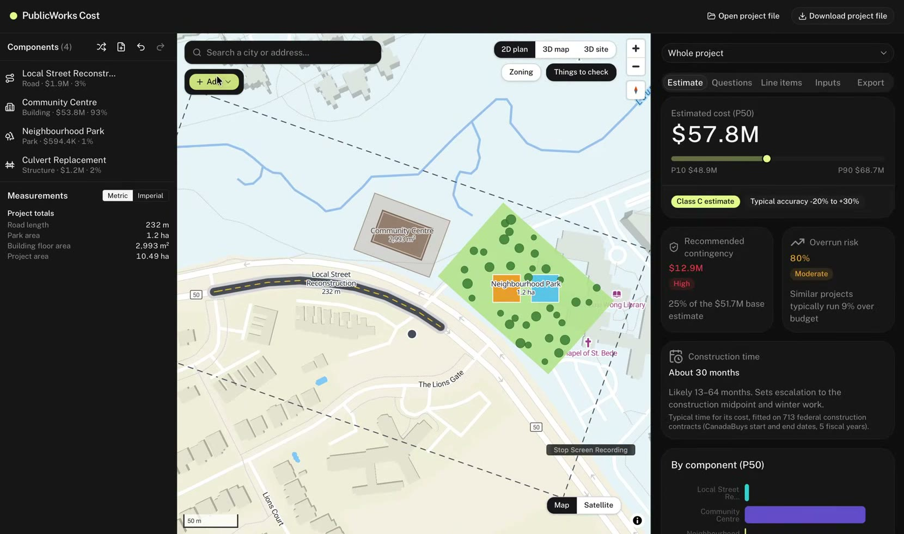
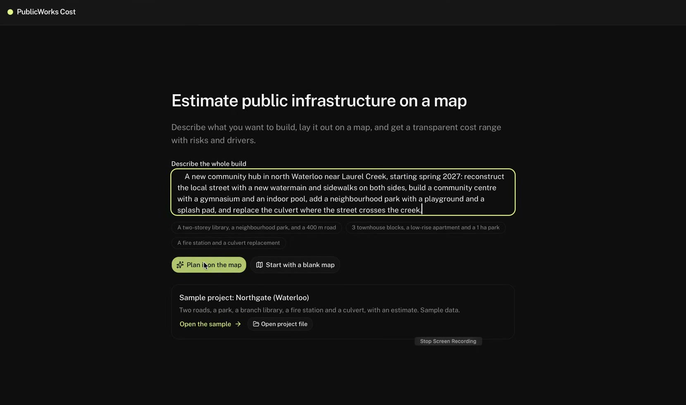
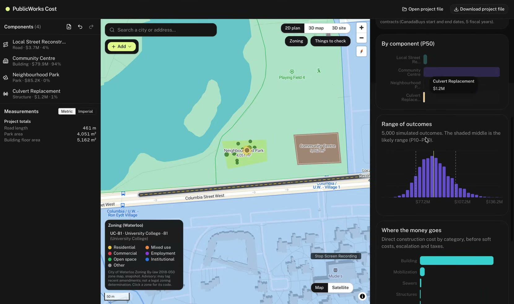
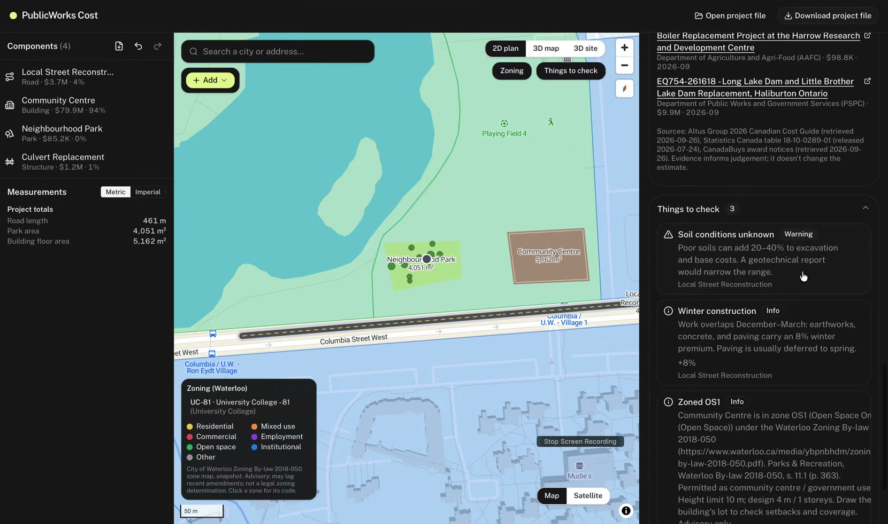
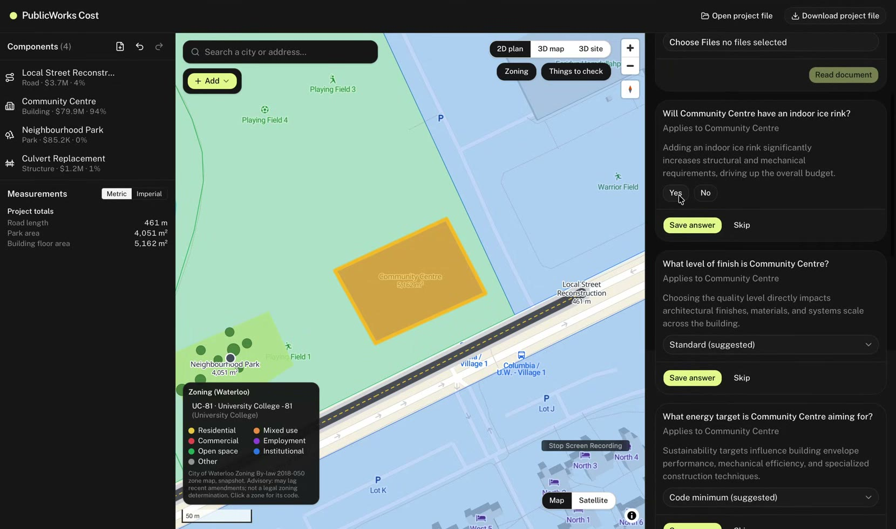

# PublicWorks Cost

Map-based, AI-assisted cost estimating for Canadian public infrastructure. Describe the whole build, lay out roads, parks, buildings and structures on a map, and get a transparent cost range (P10 / P50 / P90) with risks, drivers and flags.

> All pricing and reference data in this repo is **illustrative sample data**, not real cost data.

**[▶ Watch the demo video](https://www.youtube.com/watch?v=2-e5I5Dqry4)** · **[Try it live](https://publicworkscost.vercel.app)**



## Screenshots

**Describe the whole build in plain English**



**See the range of outcomes and where the money goes**



**Flag risks and zoning issues, and answer questions that narrow the estimate**

<p>
  
  
</p>

## Requirements

- Node.js 20.9+ (developed on Node 26)
- pnpm 10+

## Getting started

```bash
pnpm install
cp .env.example .env.local   # optional: add keys (the app works without them)
pnpm dev                     # http://localhost:3000 → redirects to /en
```

## Scripts

| Command | What it does |
| --- | --- |
| `pnpm dev` | Start the dev server |
| `pnpm build` / `pnpm start` | Production build and server |
| `pnpm typecheck` | Generate route types and run `tsc` |
| `pnpm lint` | ESLint |
| `pnpm test` | Vitest (engine, geometry, store) |
| `pnpm format` | Prettier |

## Stack

Next.js (App Router) · TypeScript strict · Tailwind CSS + shadcn/ui · next-intl (EN/FR) · Zustand · zod · Vitest · MapLibre GL + Terra Draw + Turf (map) · Vercel.

No database: projects live in memory and are kept only by downloading a project file.
